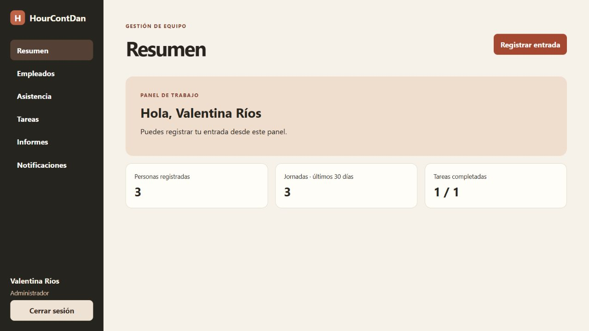
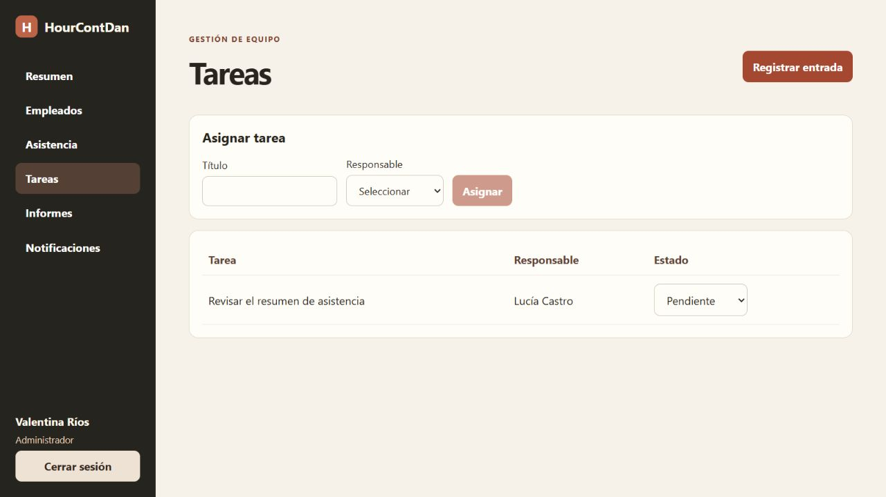

# HourContDan

Aplicación de portafolio para gestión de empleados, asistencia, tareas e informes. Angular en `front-end`, NestJS en `backend` y MySQL como base de datos. Paleta crema, carbón y terracota.

## Instalar desde cero en otro servidor MySQL

1. En MySQL Workbench conéctate a tu servidor local. Abre `backend/database/schema.sql`, ejecuta todo el script y actualiza **Schemas**. Se crea `hourcontdan` con cuatro tablas. El script puede volver a ejecutarse.
2. En PowerShell, desde `backend`, ejecuta `Copy-Item .env.example .env` y completa la contraseña local de MySQL en `.env`. Mantén ese archivo privado.
3. Desde `backend`, ejecuta `npm.cmd install`, `node database/seed.cjs`, `npm.cmd run build` y `npm.cmd start`.
4. En otra terminal, desde `front-end`, ejecuta `npm.cmd install` y `npm.cmd start`. Abre http://localhost:4200.

## Cuentas de demostración

Todas usan `DemoHour2026!`. Son cuentas locales de prueba. No publiques el proyecto con estas credenciales.

| Correo | Rol |
| --- | --- |
| admin@example.test | Administrador |
| gerente@example.test | Gerente |
| empleado@example.test | Empleado |

Prueba el flujo iniciando como administrador y asignando una tarea a Lucía. Luego entra como empleada, revisa la notificación, actualiza la tarea y registra una entrada y una salida. Finalmente vuelve al perfil de gerente para ver las jornadas y el informe.

El informe agrega horas de jornadas cerradas iniciadas durante los últimos 30 días y tareas completadas por persona. Las notificaciones aparecen dentro del sistema al asignar tareas. Gerentes y administradores ven todo el equipo, mientras que cada empleado ve sus registros. Las sesiones caducan a las ocho horas o al reiniciar el servidor. La marcación se hace desde la web y usa la hora del servidor. Se guarda en UTC y se muestra con la zona horaria del navegador. Esta base permite editar el nombre del empleado. Reglas de nómina, supervisión por departamento y correcciones de jornada requieren definir un flujo adicional.

## Capturas

